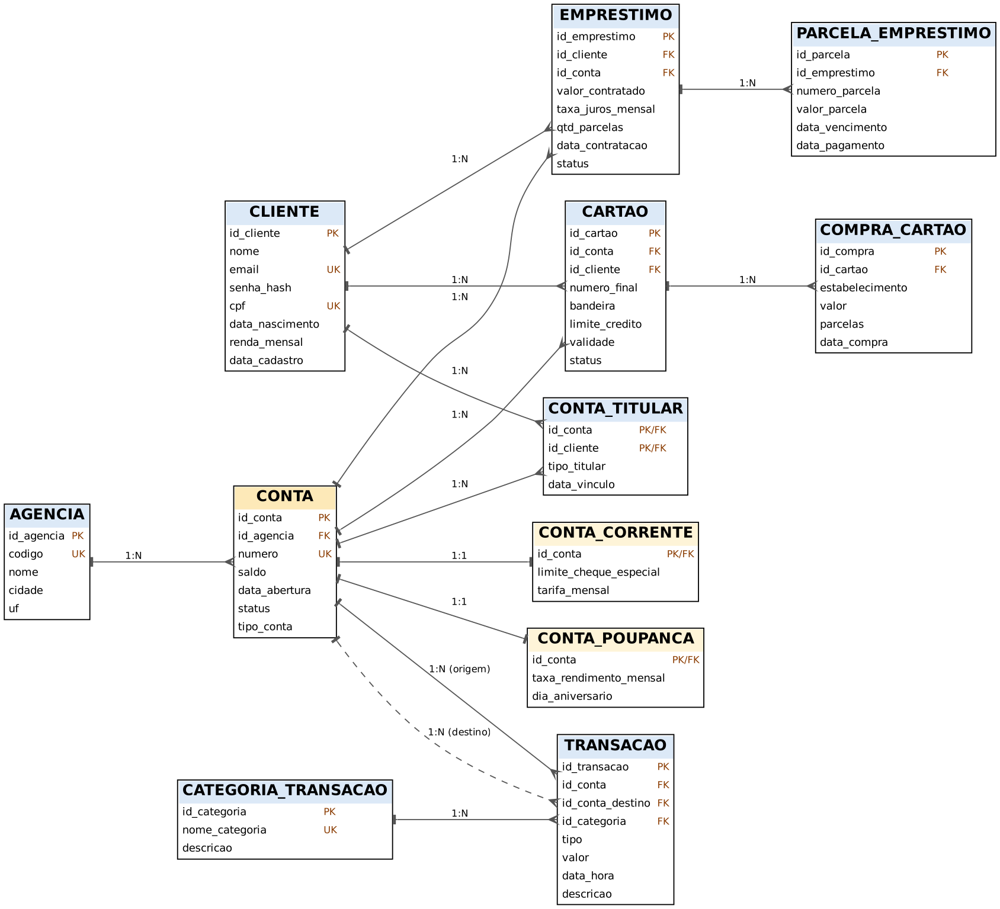

# 🏦 Aurum Bank — Sistema Bancário


Projeto **A3** da disciplina de **Banco de Dados** — modelagem e implementação completa do banco de dados de um banco digital fictício, do DER às transações, em **PostgreSQL**.

> **Disciplina:** Banco de Dados · **Professor:** _[preencher]_ · **Instituição:** _[preencher]_ · **Semestre:** _[preencher]_

---

## 📑 Sumário

- [Sobre o projeto](#-sobre-o-projeto)
- [Funcionalidades modeladas](#-funcionalidades-modeladas)
- [Modelo de dados](#-modelo-de-dados)
- [Regras de negócio e integridade](#-regras-de-negócio-e-integridade)
- [Segurança e LGPD](#-segurança-e-lgpd)
- [Estrutura do repositório](#-estrutura-do-repositório)
- [Como executar](#-como-executar)
- [Exemplos de consultas](#-exemplos-de-consultas)
- [Transações e concorrência](#-transações-e-concorrência)
- [Integrantes](#-integrantes)

---

## 💡 Sobre o projeto

O **Aurum Bank** é um banco digital fictício. O banco de dados sustenta contas correntes e poupança (inclusive conjuntas), extrato de movimentações, cartão de crédito e empréstimos parcelados, com todas as operações registradas de forma auditável.

O trabalho cobre **todo o ciclo de vida do banco de dados**:

| Etapa | Entregável |
|-------|-----------|
| 1. Modelo conceitual | DER (`docs/der.png`) |
| 2. Modelo lógico | Esquema normalizado até a 3FN |
| 3. DDL | Script reexecutável com todas as restrições |
| 4. DML | Carga de dados, operações do dia a dia e cenário de concorrência |
| 5. DQL | 14 consultas simples + 22 com JOIN, GROUP BY e HAVING |
| 6. Avançado | 10 subconsultas, 2 views, DCL (GRANT/REVOKE) e TCL (7 passos) |
| 7. Índices | Base com 400 mil transações e `EXPLAIN ANALYZE` antes/depois |
| 8. Concorrência | Plano de concorrência testado com duas sessões reais |
| 9. Backup | `pg_dump`/restauração com conferência das 12 tabelas |
| 10. Administração, segurança e LGPD | Papéis, auditoria, anonimização e relatório final |

### Mapa da rubrica da A3

| Critério | Onde está |
|----------|-----------|
| DER | `docs/der.png` e `docs/Projeto_A3_Aurum_Bank.docx` |
| Modelo lógico + DDL | `sql/01_script_ddl.sql` e `docs/Projeto_A3_Aurum_Bank.docx` |
| DML/DQL + índices | `sql/02` a `sql/05`, `sql/06a_carga_volume.sql`, `sql/06b_indices.sql` |
| Transações + backup | `sql/07_concorrencia.sql`, `testes/concorrencia.sh`, `backup/`, `testes/backup_teste.sh` |
| Relatório final (6 a 10 páginas) | `docs/Relatorio_Final_Administracao_Seguranca_LGPD.docx` |
| Defesa técnica | `docs/roteiro_apresentacao_e_defesa.md` |
| Log de contribuições | `docs/log_contribuicoes.md` |

## 🧩 Funcionalidades modeladas

- **Contas:** corrente (cheque especial e tarifa mensal) e poupança (rendimento mensal), vinculadas a uma agência.
- **Titularidade:** uma conta pode ter vários titulares (conta conjunta) e um cliente pode ter várias contas.
- **Extrato:** depósitos, saques, transferências, pagamentos e tarifas, classificados por categoria.
- **Cartão de crédito:** limite próprio, compras à vista e parceladas.
- **Empréstimos:** contratos com juros e parcelas (Tabela Price), com controle de pagamento e atraso.

## 🗂️ Modelo de dados



**12 tabelas:** `agencia`, `cliente`, `conta`, `conta_corrente`, `conta_poupanca`, `conta_titular`, `categoria_transacao`, `transacao`, `cartao`, `compra_cartao`, `emprestimo` e `parcela_emprestimo`.

### Padrões de modelagem aplicados

| Padrão | Onde |
|--------|------|
| **Especialização (supertipo/subtipo)** | `conta` → `conta_corrente` e `conta_poupanca` (subtipos reaproveitam a chave primária) |
| **Relacionamento N:N** | `cliente` ↔ `conta` resolvido por `conta_titular` |
| **Tabela de eventos** | `transacao` registra cada movimentação e, em transferências, referencia conta de origem **e** de destino |
| **Entidade fraca / detalhe** | `parcela_emprestimo` e `compra_cartao` dependem do contrato/cartão |

O dicionário de dados completo está no relatório: [`docs/Projeto_A3_Aurum_Bank.docx`](docs/Projeto_A3_Aurum_Bank.docx).

## ✅ Regras de negócio e integridade

- `CHECK (valor > 0)`: todo lançamento tem valor positivo; o sentido (entrada ou saída) vem do tipo.
- Transferência **exige** conta de destino, e o destino deve ser diferente da origem.
- Status e tipos restritos por `CHECK` (conta `ATIVA/BLOQUEADA/ENCERRADA`, cartão `ATIVO/BLOQUEADO/CANCELADO` etc.).
- `UNIQUE` em e-mail, CPF, código da agência e número da conta.
- `ON DELETE RESTRICT` protege o histórico financeiro: **conta com extrato** e **cliente com empréstimo** não podem ser apagados.
- `ON DELETE CASCADE` para o que acompanha o dono (titularidade, cartões, parcelas).

## 🔒 Segurança e LGPD

- Senhas guardadas **somente como hash**; cartão guarda apenas os **4 últimos dígitos**.
- Views `vw_contas_atendimento` e `vw_extrato_resumo` expõem só o necessário, **sem CPF, senha, data de nascimento ou renda**.
- Papel `atendimento` com `GRANT` apenas nas views: ler a tabela `cliente` ou alterar saldo gera `permission denied`.
- Extrato **imutável** para a aplicação (só `INSERT`) e **trilha de auditoria** (`log_auditoria`) de saldo e cadastro.
- **LGPD:** função `anonimizar_cliente()` descaracteriza o cadastro e mantém o histórico financeiro exigido por lei.
- Todos os dados do projeto são **fictícios**.

## 📁 Estrutura do repositório

```
aurum-bank/
├── docs/
│   ├── Projeto_A3_Aurum_Bank.docx                          # DER, modelo lógico, dicionário e consultas
│   ├── Relatorio_Final_Administracao_Seguranca_LGPD.docx   # relatório final (8 páginas)
│   ├── log_contribuicoes.md                                # quem fez o quê, por marco
│   ├── roteiro_apresentacao_e_defesa.md                    # pitch de 10 min + perguntas da arguição
│   ├── der.png                                             # diagrama entidade-relacionamento
│   └── grafico_indices.png                                 # resultado dos índices
├── sql/
│   ├── 01_script_ddl.sql                   # cria todas as tabelas (reexecutável)
│   ├── 01b_carga_dados.sql                 # dados fictícios (reexecutável)
│   ├── 02_operacoes_dml.sql                # INSERT, UPDATE, DELETE e concorrência com FOR UPDATE
│   ├── 03_consultas_dql.sql                # 14 consultas simples
│   ├── 04_consultas_dql2.sql               # 22 consultas: JOIN, GROUP BY, HAVING, agregações
│   ├── 05_subconsultas_views_dcl_tcl.sql   # subconsultas, views, DCL e TCL
│   ├── 06a_carga_volume.sql                # 400 mil transações (só no banco de desempenho)
│   ├── 06b_indices.sql                     # índices + EXPLAIN ANALYZE antes e depois
│   ├── 07_concorrencia.sql                 # plano de concorrência (travas, deadlock, roteiro)
│   └── 08_administracao_seguranca_lgpd.sql # papéis, auditoria, anonimização, rotina de DBA
├── backup/
│   ├── backup.sh                           # pg_dump + checksum + retenção de 7 dias
│   └── restore.sh                          # restaura em banco novo
├── testes/
│   ├── concorrencia.sh                     # 5 cenários com duas sessões psql simultâneas
│   └── backup_teste.sh                     # backup → restauração → conferência → desastre
├── .gitignore
└── README.md
```

## 🚀 Como executar

**Pré-requisito:** PostgreSQL 16 (ou similar) e `psql`.

```bash
# 1. Base de exemplo
createdb aurum
psql -d aurum -f sql/01_script_ddl.sql
psql -d aurum -f sql/01b_carga_dados.sql
psql -d aurum -f sql/03_consultas_dql.sql
psql -d aurum -f sql/04_consultas_dql2.sql
psql -d aurum -f sql/05_subconsultas_views_dcl_tcl.sql
psql -d aurum -f sql/08_administracao_seguranca_lgpd.sql

# 2. Índices (base grande, separada)
createdb aurum_perf
psql -d aurum_perf -f sql/01_script_ddl.sql
psql -d aurum_perf -f sql/01b_carga_dados.sql
psql -d aurum_perf -f sql/06a_carga_volume.sql
psql -d aurum_perf -f sql/06b_indices.sql

# 3. Testes de concorrência e de backup
bash testes/concorrencia.sh
bash testes/backup_teste.sh
```

Pelo **pgAdmin**: crie o banco, abra o *Query Tool* e execute os arquivos na ordem acima.

> ⚠️ O `02_operacoes_dml.sql` **altera** os dados. Para repetir o teste do zero, rode `01` e `01b` novamente.

## 🔎 Exemplos de consultas

**Saldo total por agência (apenas contas ativas):**

```sql
SELECT ag.nome, SUM(c.saldo) AS saldo_total
FROM conta c
JOIN agencia ag ON ag.id_agencia = c.id_agencia
WHERE c.status = 'ATIVA'
GROUP BY ag.id_agencia, ag.nome
ORDER BY saldo_total DESC;
```

**Clientes sem nenhum cartão (`NOT EXISTS`):**

```sql
SELECT cl.nome
FROM cliente cl
WHERE NOT EXISTS (SELECT 1 FROM cartao ca WHERE ca.id_cliente = cl.id_cliente)
ORDER BY cl.nome;
```

**Empréstimos com parcelas vencidas e não pagas:**

```sql
SELECT e.id_emprestimo, cl.nome, COUNT(*) AS parcelas_vencidas, SUM(p.valor_parcela) AS valor_em_atraso
FROM parcela_emprestimo p
JOIN emprestimo e ON e.id_emprestimo = p.id_emprestimo
JOIN cliente cl   ON cl.id_cliente   = e.id_cliente
WHERE p.data_pagamento IS NULL AND p.data_vencimento < CURRENT_DATE
GROUP BY e.id_emprestimo, cl.nome
ORDER BY valor_em_atraso DESC;
```

## ⚡ Índices (base com 400 mil transações)

| Consulta | Antes | Depois |
|----------|-------|--------|
| Extrato de uma conta (30 dias) | 30,4 ms (Seq Scan) | 0,17 ms (Index Scan) |
| Transferências recebidas (índice parcial) | 21,3 ms | 0,01 ms |
| Parcelas vencidas em aberto (índice parcial) | 3,3 ms | 1,1 ms |

Detalhes, gráfico e custo dos índices no relatório final.

## 💾 Backup testado

`testes/backup_teste.sh` faz o backup, restaura em um banco novo, confere contagem e hash de cada uma das 12 tabelas e simula um desastre (`DROP TABLE`) para recuperar: resultado **idêntico** em ambos os bancos testados.

## 🔁 Transações e concorrência

**Transferência atômica:** débito, crédito e lançamento no extrato acontecem juntos; se um falhar, tudo é desfeito.

```sql
BEGIN;
UPDATE conta SET saldo = saldo - 1000.00 WHERE id_conta = 1 AND saldo >= 1000.00;
UPDATE conta SET saldo = saldo + 1000.00 WHERE id_conta = 3;
INSERT INTO transacao (id_conta, id_conta_destino, tipo, valor, descricao)
VALUES (1, 3, 'TRANSFERENCIA', 1000.00, 'Transferência');
COMMIT;
```

**Dois saques simultâneos:** `SELECT ... FOR UPDATE` trava a linha da conta; a segunda transação espera o `COMMIT` e já enxerga o saldo atualizado, evitando saldo indevido.

O script `05` demonstra ainda `ROLLBACK` e `SAVEPOINT`, e devolve a base ao estado original ao final. O `testes/concorrencia.sh` reproduz com duas sessões reais a perda de atualização (saldo 500 em vez de 0), o deadlock e a prevenção por ordem de travas.

## 👥 Integrantes

| Nome | RA |
|------|----|
| _[Nome do integrante 1]_ | _[RA]_ |
| _[Nome do integrante 2]_ | _[RA]_ |
| _[Nome do integrante 3]_ | _[RA]_ |

---

<sub>Projeto acadêmico · dados fictícios, sem informações pessoais reais (LGPD).</sub>
